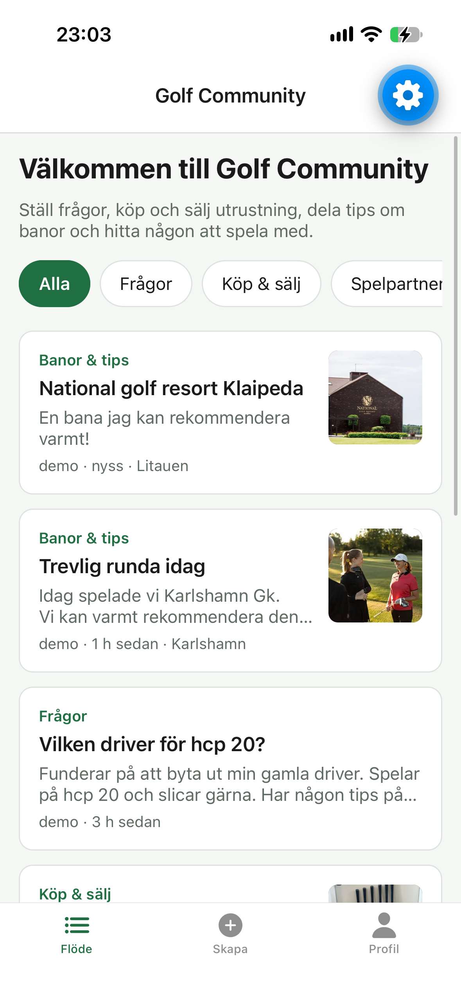
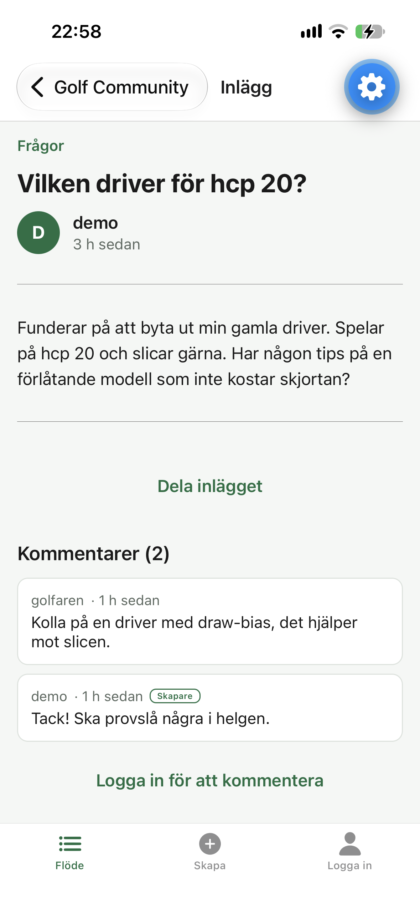
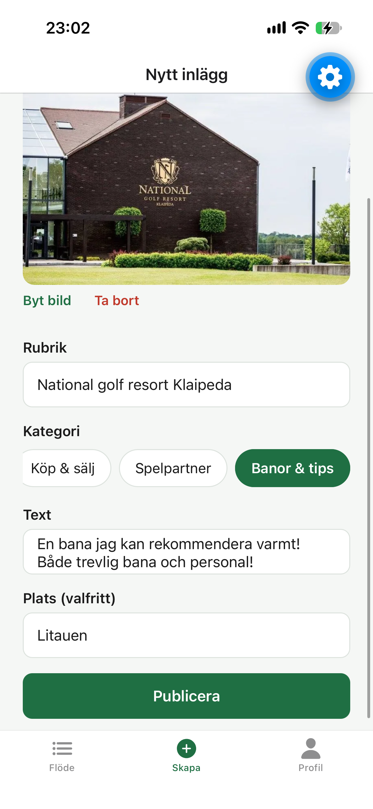
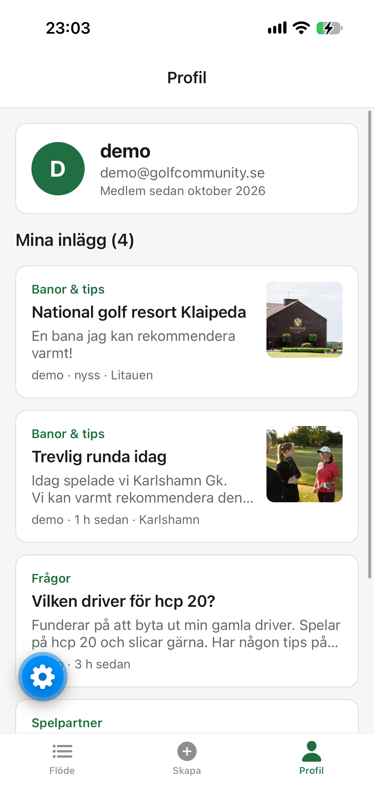

# Golf Community

En mobilapp där golfare kan ställa frågor, köpa och sälja utrustning, hitta spelpartners och dela tips om banor.
Appen är byggd i React Native (Expo) och hämtar all data från ett eget REST-API byggt i Spring Boot.

> Individuellt projekt, alternativ 3: Community-app.

<p>
  
  &nbsp;&nbsp;&nbsp;&nbsp;&nbsp;&nbsp;
  
  &nbsp;&nbsp;&nbsp;&nbsp;&nbsp;&nbsp;
  
  &nbsp;&nbsp;&nbsp;&nbsp;&nbsp;&nbsp;
  
</p>

## Funktioner

- **Konto:** registrera, logga in och logga ut. Inloggningen sparas säkert på telefonen, så man förblir inloggad mellan starterna.
- **Flöde:** inlägg sorterade med nyast först, filtrering på kategori och pull-to-refresh. Flödet hämtar 10 inlägg åt gången och laddar fler när man scrollar ner (infinite scroll).
- **Inlägg:** skapa, visa, redigera och ta bort. Bara den som skrev inlägget kan ändra eller ta bort det.
- **Bilder:** lägg till, byt eller ta bort en bild i ett inlägg med kameran eller från galleriet. Bilden visas i flödet och i detaljvyn.
- **Kommentarer:** skriv och ta bort kommentarer. Inläggets skapare markeras med en etikett.
- **Profil:** visar användarens uppgifter och egna inlägg.
- **Dela:** dela ett inlägg via telefonens delningsmeny.
- **Laddning, fel och tomma lägen** visas på alla skärmar, med möjlighet att försöka igen.

## Teknik

| Del | Teknik |
|---|---|
| App | React Native, Expo SDK 57, JavaScript, React Navigation (flikar och stackar) |
| App, övrigt | expo-secure-store (token), expo-image-picker (kamera och galleri), Context för inloggningsläget |
| Backend | Java 21, Spring Boot 4, Spring Web MVC, Spring Data JPA, Spring Security (JWT), Bean Validation |
| Databas | PostgreSQL 17 i Docker |

## REST API

Appen använder ett eget REST API byggt i Spring Boot, som ligger i `backend/`. Det sparar data i PostgreSQL.
Alla endpoints finns under [API](#api) längre ner.

## Registrering och inloggning

1. Användaren registrerar sig eller loggar in med e-post och lösenord (`POST /api/auth/register` eller `POST /api/auth/login`).
2. Backend kontrollerar uppgifterna och svarar med en JWT-token och användarens uppgifter. Lösenord sparas som BCrypt-hash i databasen.
3. Appen sparar token i SecureStore.
4. Varje skyddat anrop skickar token i headern `Authorization: Bearer <token>`.
5. När appen startar läses token från SecureStore, så användaren förblir inloggad. Token gäller i 7 dagar.
6. Vid utloggning tas token bort från SecureStore. Svarar backend `401`, till exempel när token har gått ut, loggas användaren ut automatiskt.

Misslyckas inloggningen visas ett tydligt felmeddelande.

Utloggade användare kan läsa flödet och inlägg. Att skapa, redigera, ta bort, kommentera och se profilen kräver inloggning.
Skärmarna för detta finns bara i navigationen när användaren är inloggad, och backend kontrollerar alltid behörigheten.

## Lokal lagring

| Vad | Var | Varför |
|---|---|---|
| Token och användaruppgifter | SecureStore | Autentiseringsinformation lagras krypterat |

Lösenord sparas aldrig lokalt. Övrig data hämtas från API:t och hålls i state.

## Mobilfunktioner

- **Kamera och bildgalleri (expo-image-picker):** lägg till en bild när ett inlägg skapas eller redigeras. Appen hanterar nekad behörighet (med länk till inställningarna), avbrutet val, kamera eller galleri som inte är tillgängligt och fel vid uppladdning.
- **Dela (Share):** dela ett inlägg via telefonens delningsmeny.

## Projektstruktur

```
golfCommunityApp/
├── app/        React Native-appen (Expo)
│   └── src/
│       ├── api/          Anrop till backend (client.js samlar fetch, token och felhantering)
│       ├── components/   Återanvändbara komponenter (form/, posts/, ui/)
│       ├── constants/    Färger
│       ├── context/      AuthContext: inloggning, utloggning och token
│       ├── hooks/        Egna hooks, t.ex. useCategories
│       ├── navigation/   Flikar och stackar
│       ├── screens/      En fil per skärm
│       └── utils/        Formatering av datum och pris
├── backend/    Spring Boot-API:t
│   └── src/main/java/se/golfCommunity/
│       ├── auth/       Registrering, inloggning och JWT
│       ├── category/   Kategorier
│       ├── comment/    Kommentarer
│       ├── common/     Felhantering och gemensamma svarstyper
│       ├── config/     Säkerhet, JWT, bildmappen och demodata
│       ├── image/      Uppladdning av bilder
│       ├── post/       Inlägg: CRUD, filtrering, sortering och sidindelning
│       └── user/       Användare och profil
└── docs/       Skärmdumpar till README
```

## Kom igång

### Krav

- [Docker Desktop](https://www.docker.com/products/docker-desktop/) (för databasen)
- Java 21 eller senare
- [Node.js](https://nodejs.org/) (LTS)
- Appen **Expo Go** (senaste versionen, med stöd för Expo SDK 57) på telefonen, eller en Android-emulator i Android Studio

### 1. Starta databasen

Från projektets rotmapp:

```bash
cd backend
docker compose up -d
```

### 2. Starta backend

Öppna `backend` i IntelliJ och kör `GolfCommunityApiApplication`, eller kör från mappen `backend`:

```bash
./mvnw spring-boot:run
```

API:t startar på `http://localhost:8080`. Kontrollera med `http://localhost:8080/api/health`.

Vid första starten skapas kategorier, två demokonton och 18 demoinlägg, varav två med bild.
Det räcker för att infinite scroll ska synas i flödet.

### 3. Starta appen

Från projektets rotmapp:

```bash
cd app
npm install
cp .env.example .env
```

Öppna `.env` och sätt adressen till backend:

| Kör appen på | Värde |
|---|---|
| Fysisk telefon med Expo Go | Datorns IP-adress på wifi-nätet, t.ex. `http://192.168.1.23:8080` |
| Android-emulator | `http://10.0.2.2:8080` |

OBS: Om du kör expo go appen måste telefonen och datorn vara på samma nätverk.

```bash
npx expo start
```

Skanna QR-koden med Expo Go, eller tryck `a` för att öppna appen i Android-emulatorn.

### Demokonton

| E-post | Lösenord |
|---|---|
| demo@golfcommunity.se | demo1234 |
| golfaren@golfcommunity.se | demo1234 |

### Börja om med tom databas

Från mappen `backend`:

```bash
docker compose down -v
docker compose up -d
```

`-v` raderar all data i databasen. Starta sedan om backend, så skapas demodata igen.


## API

Alla anrop och svar är JSON, utom bilduppladdningen som är `multipart/form-data`.
Skyddade anrop skickar `Authorization: Bearer <token>`.

| Metod | Adress | Inloggning | Beskrivning |
|---|---|---|---|
| GET | `/api/health` | | Hälsokontroll |
| POST | `/api/auth/register` | | Skapa konto, returnerar token |
| POST | `/api/auth/login` | | Logga in, returnerar token |
| GET | `/api/categories` | | Alla kategorier |
| GET | `/api/posts` | | Inlägg: `q`, `category`, `sort`, `page`, `size` |
| GET | `/api/posts/{id}` | | Ett inlägg |
| POST | `/api/posts` | ✓ | Skapa inlägg |
| PUT | `/api/posts/{id}` | ✓ ägare | Uppdatera inlägg |
| DELETE | `/api/posts/{id}` | ✓ ägare | Ta bort inlägg |
| GET | `/api/posts/{id}/comments` | | Kommentarer på ett inlägg |
| POST | `/api/posts/{id}/comments` | ✓ | Skriv kommentar |
| DELETE | `/api/comments/{id}` | ✓ ägare | Ta bort kommentar |
| POST | `/api/images` | ✓ | Ladda upp bild (JPEG, PNG eller WebP, max 5 MB) |
| GET | `/uploads/{filnamn}` | | Hämta en uppladdad bild |
| GET | `/api/users/me` | ✓ | Min profil |
| GET | `/api/users/me/posts` | ✓ | Mina inlägg |

`GET /api/posts` svarar med en sida:

```json
{
  "content": [ { "id": 1, "title": "...", "category": { }, "author": { } } ],
  "page": 0,
  "size": 10,
  "totalElements": 18,
  "totalPages": 2,
  "hasNext": true
}
```

Alla fel har samma format:

```json
{
  "status": 400,
  "message": "Kontrollera uppgifterna i formuläret.",
  "fieldErrors": { "title": "Ange en rubrik." },
  "timestamp": "2026-10-22T14:00:00Z"
}
```

| Status | Betydelse |
|---|---|
| 400 | Ogiltig förfrågan eller valideringsfel |
| 401 | Inte inloggad, eller token har gått ut |
| 403 | Inloggad, men inte ägare till innehållet |
| 404 | Finns inte |
| 409 | Konflikt, t.ex. e-post eller användarnamn upptaget |
| 413 | Bilden är för stor |
| 500 | Oväntat serverfel |

## Designval

- **Token i SecureStore.** Token sparas krypterat på telefonen, inte i AsyncStorage. Svarar API:t `401` loggas användaren ut automatiskt.
- **Ett ställe för alla anrop.** `client.js` sköter adress, token, timeout och felmeddelanden, så skärmarna behöver bara anropa funktioner som `fetchPosts()`.
- **Behörighet kontrolleras i backend.** Appen döljer redigera- och ta bort-knapparna för andras inlägg, men det är backend som avgör. Den som försöker ändra någon annans inlägg får `403`.
- **Validering på båda sidor.** Appen validerar formulär direkt, så användaren får snabb återkoppling. Backend validerar alltid igen, och dess fältfel visas vid rätt fält.
- **Separata laddnings- och fellägen.** Detaljvyn hämtar inlägget och kommentarerna parallellt, så att ett fel i kommentarerna inte döljer inlägget. I flödet har första sidan och nästa sida egna lägen, så att ett fel längre ner inte tar bort inläggen som redan visas.
- **Stabil infinite scroll.** Samma sida hämtas aldrig två gånger samtidigt, svar som hör till en gammal kategori ignoreras, och dubbletter filtreras bort om nya inlägg har skapats under tiden.
- **Bilder laddas upp separat.** När användaren väljer en bild laddas den upp direkt, och inlägget sparar bara bildens sökväg (`/uploads/...`). Sökvägen är relativ, så bilderna fungerar även när datorns IP-adress ändras.
- **Uppladdade bilder finns inte i Git.** `uploads/` ignoreras. Demobilderna ligger i `backend/src/main/resources/seed-images/` och kopieras dit när demodata skapas.

## Kända begränsningar

- När man går tillbaka till flödet hämtas första sidan om, så att nya, ändrade och borttagna inlägg syns. Har man scrollat förbi de första 10 inläggen börjar listan om från början.
- Backend körs lokalt, så adressen i `.env` måste uppdateras om datorn byter nätverk.
- Bilder sparas på serverns disk. En bild som byts ut, eller hör till ett borttaget inlägg, tas inte bort från disken.
- Sökning (`q`) och sortering (`sort`) finns i API:t men används inte i appen ännu.
- Ingen moderering eller adminroll.
